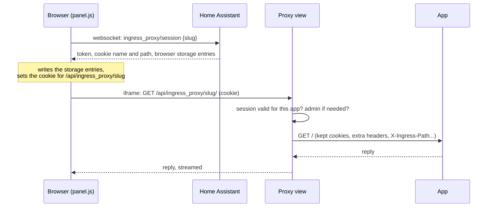

# Development

How Ingress Proxy works inside. [CONTRIBUTING.md](../CONTRIBUTING.md) has the file map and how to check a change.

Unlike most integrations, Ingress Proxy has no coordinator and no entities: nothing is polled.
Each config entry is one app, and what it adds to Home Assistant is a sidebar panel and a route on Home Assistant's
web server.

## Start-up

`async_setup` (once, when Home Assistant starts) builds what all apps share and keeps it in `hass.data[DOMAIN]` as an
`IngressProxyData`:

- the proxy view, `IngressProxyView`, at `/api/ingress_proxy/{slug}/{path}`
- the panel script folder, served at `/ingress_proxy_static/`
- the `ingress_proxy/session` websocket command
- the session store (`sessions.py`) and the kept-cookie jar (`cookies.py`), loaded from `.storage/ingress_proxy.cookies`

`async_setup_entry` (per app) turns the entry's data into a `ProxiedApp`, adds it to `IngressProxyData.apps`, and
registers its panel. `async_unload_entry` removes the panel and the app and ends the app's sessions, so Reconfigure
(which reloads the entry) takes effect at once. `async_remove_entry` deletes the app's kept cookies.

## Opening a panel

The panel renews the session every 20 minutes (sessions last an hour), when the tab comes back after a long time in
the background, and when Home Assistant's websocket reconnects.

## A request through the proxy

`IngressProxyView._proxy`, in order:

1. Unknown slug: 404. No valid session for this app, or a non-administrator's session on an administrators-only app:
   401. Nothing reaches the app before this point.
2. `/api/ingress_proxy/<slug>` without the trailing `/`: 307 to the address with it, so relative links resolve.
3. The path after the prefix is taken from the raw URL, still percent-encoded, and refused with 400 if it contains a
   `..` segment (`rewrite.has_parent_segment`).
4. `rewrite.upstream_url` builds the app's URL; `rewrite.request_headers` builds the headers: the browser's, minus
   those in `REQUEST_HEADERS_TO_DROP`, plus the forwarded headers, the cookies (the browser's without the session
   cookie, plus the kept ones) and the app's extra headers.
5. A websocket upgrade goes to `_proxy_websocket`, anything else to `_proxy_http`.

`_proxy_http` sends the request with the body streamed straight through, and streams the reply back in 64 KiB chunks
as it arrives. Reply headers go through `rewrite.response_headers` (drops `RESPONSE_HEADERS_TO_DROP`, rewrites
`Location`, removes `frame-ancestors`). `Set-Cookie` either updates the jar (persist login) or is rewritten for the
browser by `cookies.rewrite_for_browser`. If the app breaks off mid-reply, the browser's connection is closed rather
than finished, so the browser knows the reply is incomplete.

`_proxy_websocket` connects to the app first (offering the browser's subprotocols), then accepts the browser's
websocket with the subprotocol the app chose. `_relay` runs two `_pump` tasks, one each way. When one side closes,
its pump closes the other side with the same close code (`rewrite.close_code_to_send` turns codes that may not be sent,
such as 1006, into 1000), then both tasks are cancelled and awaited so neither outlives the request.

## The HTTP client

`client.async_get_client` makes the proxy's own aiohttp sessions (one with certificate checks, one without) rather
than using Home Assistant's shared one:

- `DummyCookieJar`: the client keeps no cookies, so one person's login can't leak into another's requests. The
  cookies sent are exactly those `_proxy` chose.
- `auto_decompress=False`: compressed replies pass through byte for byte, with their `Content-Encoding` and
  `Content-Length`.
- No total timeout, only a 10-second connect timeout: streams and long downloads mustn't be cut off.

## Why things are the way they are

- **A cookie, not a token in the URL.** An iframe can't send Home Assistant's bearer token, and a token in the URL
  would be lost on the app's first link. The cookie's path is limited to the app, so each app's panel has its own.
- **Every value of the session cookie is tried.** A browser can hold the cookie for more than one path (an older
  Ingress Proxy kept one at `/api/ingress_proxy` for every app) and sends them all; aiohttp's `request.cookies` keeps
  only the last, which can be the stale one. `cookies.values_named` reads them all, and the panel deletes the old one.
- **The session is checked on every request**, including each websocket upgrade, because the iframe's requests don't
  pass through Home Assistant's own authentication (`requires_auth = False`).
- **Nothing in the reply body is rewritten.** Rewriting HTML and scripts breaks more apps than it fixes. Apps that need
  their links adjusted have a base-path setting or read `X-Ingress-Path`.
- **Set-Cookie is parsed by hand.** `http.cookies.SimpleCookie` reads an attribute it doesn't know, such as Chrome's
  `Priority=High`, as a second cookie.
- **The panel's element name carries the version**: a browser that kept the old script loaded across
  an update uses the new element instead of failing to redefine the old one.
- **The kept cookies' file format** is `{slug: {cookie name: value}}`. Keep it that way, or migrate it, so people stay
  logged in across updates.

## Tests and releases: the files

Gitea is the main copy of this repository; it push-mirrors to GitHub, the public copy people install from.

| File | What it does |
|---|---|
| `.gitea/workflows/test.yml` | Runs every check on each push to Gitea (lint, the tests and building the zip, on Python 3.14, and the panel scripts on Node 20), with no actions downloaded from GitHub |
| `.gitea/workflows/release.yml` | Publishes a release on Gitea (Run workflow button, or a pushed version tag); its tag then reaches GitHub through the push mirror |
| `.github/workflows/release.yml` | Publishes the same release on GitHub when a version tag arrives there (or from its own Run workflow button): the copy the Marketplace installs from |
| `.github/workflows/ci.yml` | GitHub's checks on every push: lint, the tests and Home Assistant's `hassfest` (which comes from GitHub, so it runs only there) |
| `.github/workflows/validate.yml` | The Marketplace's own checks (the HACS action), which its catalog requires; GitHub only, for the same reason |
| `scripts/release_notes.py` | Shared by both release workflows: checks the version, gives the release's title, writes the notes (install steps with the zip's address on GitHub, then the changelog section) |
| `scripts/build_package.py` | Builds `dist/ingress_proxy.zip`, the same bytes every time, and checks it with `check_package.py` |
| `scripts/check_package.py` | Checks the zip the way it gets installed: one `ingress_proxy/` folder, a manifest for that domain at the repository's version, the icon, exactly the integration's files |
| `scripts/publish_gitea_release.py` | Creates or updates the Gitea release and uploads its files, through Gitea's API (standard library only) |
| `tests/test_release.py` | Tests all four scripts, publishing against a fake Gitea server |
