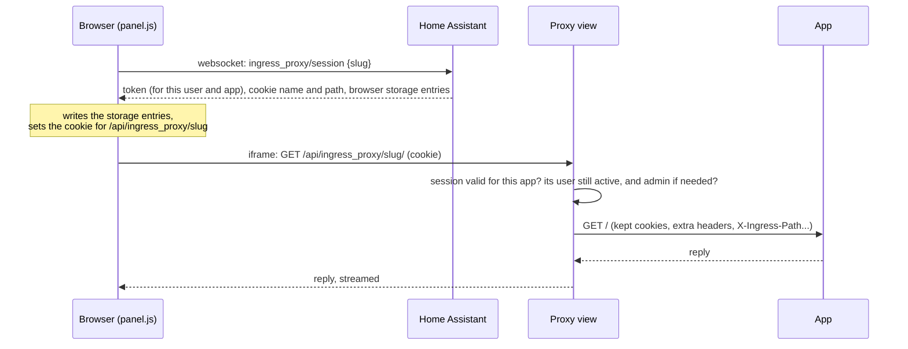

# Development

How Ingress Proxy works inside. [CONTRIBUTING.md](../CONTRIBUTING.md) has the file map and how to check a change.

Unlike most integrations, Ingress Proxy has no coordinator and no entities: nothing is polled.
Each config entry is one app, and what it adds to Home Assistant is a sidebar panel and a route on Home Assistant's
web server.

## Start-up

`async_setup` (once: when Home Assistant starts, or when the first app is added straight after installing from the
Marketplace, with no restart) builds what all apps share and keeps it in `hass.data[DATA_KEY]` (a typed `HassKey`, in
`models.py`) as an `IngressProxyData`:

- the proxy view, `IngressProxyView`, at `/api/ingress_proxy/{slug}/{path}`
- the panel script folder, served at `/ingress_proxy_static/`
- the `ingress_proxy/session` websocket command
- the session store (`sessions.py`) and the kept-cookie jar (`cookies.py`), loaded from
  `.storage/ingress_proxy.user_cookies` (the shared `.storage/ingress_proxy.cookies` of versions before 1.5.0 is
  deleted unread)
- a listener for Home Assistant's `user_removed` event, which ends that user's sessions and deletes their kept cookies
- the app logins (`logins.py`): the ESPHome Device Builder tokens, in memory only

`async_setup_entry` (per app) turns the entry's data into a `ProxiedApp`, refuses it if its address leads to a cloud
metadata service (`client.async_reaches_metadata_service`), adds it to `IngressProxyData.apps`, and registers its
panel. `async_unload_entry` removes the panel and the app, ends the app's sessions and forgets its
login token, so Reconfigure
(which reloads the entry) takes effect at once. `async_remove_entry` deletes the app's kept cookies.

## Opening a panel

The panel renews the session every 20 minutes (sessions last an hour), when the tab comes back after a long time in
the background, and when Home Assistant's websocket reconnects.

## A request through the proxy

`IngressProxyView._proxy`, in order:

1. Unknown slug: 404. No valid session for this app in its cookie (`ingress_proxy_session_<slug>`), or the session's
   Home Assistant user is gone, deactivated, or not an administrator on an administrators-only app: 401. The user is
   looked up on every request (`hass.auth.async_get_user`). Nothing reaches the app before this point.
2. `/api/ingress_proxy/<slug>` without the trailing `/`: 307 to the address with it, so relative links resolve.
3. The path after the prefix is taken from the raw URL, still percent-encoded, and refused with 400 if it contains a
   `..` segment (`rewrite.has_parent_segment`).
4. The app already has `MAX_REQUESTS_PER_APP` requests (or `MAX_WEBSOCKETS_PER_APP` websockets) open: 503 with
   `Retry-After`. Otherwise the request is counted until it finishes.
5. `rewrite.upstream_url` builds the app's URL; `rewrite.request_headers` builds the headers: the browser's, minus
   those in `REQUEST_HEADERS_TO_DROP`, plus the forwarded headers, the cookies (the browser's without any panel
   session cookie, plus the ones kept for this user) and the app's extra headers.
6. For an app with a username, `logins.UpstreamLogins.async_authorization` gives the `Authorization` header (HTTP
   Basic, or `Bearer <token>` for an ESPHome Device Builder, logging in first if there's no token yet), and
   `rewrite.with_authorization` makes it the only one. A login the app refuses is a 502 that says so, and so is
   waiting more than `LOGIN_WAIT_SECONDS` for another request's login.
7. A websocket upgrade goes to `_proxy_websocket`, anything else to `_proxy_http`.

`_proxy_http` sends the request with the body streamed straight through, and streams the reply back in 64 KiB chunks
as it arrives. Reply headers go through `rewrite.response_headers` (drops `RESPONSE_HEADERS_TO_DROP`, rewrites
`Location`, removes `frame-ancestors`). `rewrite.rewrite_location` resolves the redirect the way the browser would and
raises `RedirectOutsideApp` unless it ends up under the app's prefix; the proxy answers that with a 502. `Set-Cookie`
either updates this user's cookies in the jar (persist login) or is rewritten for the browser by
`cookies.rewrite_for_browser`, which keeps its Path under the prefix and drops `__Host-`/`__Secure-` cookies and any
named like a panel session cookie. If the app breaks off mid-reply, the browser's connection is closed rather
than finished, so the browser knows the reply is incomplete.

`_proxy_websocket` connects to the app first (offering the browser's subprotocols), then accepts the browser's
websocket with the subprotocol the app chose. Both ends take messages up to `WEBSOCKET_MAX_MESSAGE_BYTES` and are
pinged every `WEBSOCKET_HEARTBEAT_SECONDS`. `_relay` runs two `_pump` tasks, one each way. When one side closes,
its pump closes the other side with the same close code (`rewrite.close_code_to_send` turns codes that may not be sent,
such as 1006, into 1000), then both tasks are cancelled and awaited so neither outlives the request.

## Logging in to an app

An app with a username under **Login** is logged in to by Home Assistant, never by the browser (`logins.py`):

- **HTTP Basic** puts the username and password in `Authorization` on every request and websocket upgrade. The older
  ESPHome dashboard checked it on every page and websocket.
- **ESPHome Device Builder** accepts a username and password only through the `auth/login` command on its `/ws`
  websocket, and a browser's websocket can't send headers. So `async_esphome_login` opens a websocket of its own,
  reads the server-info message (`requires_auth` false: no password set, nothing to do), sends `auth/login`, and keeps
  the token from the reply. The token goes as `Authorization: Bearer <token>`, which the Device Builder takes on every
  request and on the websocket upgrade, and then tells the page it's logged in, so its login screen never shows.
  One lock per app means a page load that starts many requests at once logs in once, and after a failed login the
  proxy waits a minute before trying again (the Device Builder locks out an address after a few failures).
- A token stops working when someone presses **Log out** in the Device Builder. A 401 from the app makes the proxy
  forget it, so the next request logs in again; on `/ws`, `_esphome_logged_in` reads the first message, and if it
  says a login is needed, logs in again and reconnects before the browser's websocket is accepted.
- `WWW-Authenticate` is dropped from replies of an app with a login, so the browser never pops up a login box.

## The HTTP client

`client.async_get_client` makes the proxy's own aiohttp sessions (one with certificate checks, one without) rather
than using Home Assistant's shared one:

- `DummyCookieJar`: the client keeps no cookies, so one person's login can't leak into another's requests. The
  cookies sent are exactly those `_proxy` chose.
- `auto_decompress=False`: compressed replies pass through byte for byte, with their `Content-Encoding` and
  `Content-Length`.
- No total timeout: streams and long downloads mustn't be cut off. Connecting may take 10 seconds, and a reply may go
  quiet for `READ_IDLE_TIMEOUT_SECONDS` (5 minutes) before it's given up on. Websockets aren't affected by that; their
  heartbeat finds a dead peer instead.

## Why things are the way they are

- **A cookie, not a token in the URL.** An iframe can't send Home Assistant's bearer token, and a token in the URL
  would be lost on the app's first link. The cookie's path is limited to the app, so each app's panel has its own.
- **A session cookie per app.** Each app's session is in `ingress_proxy_session_<slug>`, limited to its path. Before
  1.5.0 every app used `ingress_proxy_session`; the panel deletes that old cookie. A browser can still hold one name
  for more than one path and sends them all; aiohttp's `request.cookies` keeps only the last, which can be a stale
  one, so `cookies.values_named` reads them all.
- **The session holds the user, not their rights.** `Session` keeps the Home Assistant user id, and `_find_session`
  looks the user up on every request, so a change to the user applies at once rather than when the token runs out.
- **The session is checked on every request**, including each websocket upgrade, because the iframe's requests don't
  pass through Home Assistant's own authentication (`requires_auth = False`).
- **Nothing in the reply body is rewritten.** Rewriting HTML and scripts breaks more apps than it fixes. Apps that need
  their links adjusted have a base-path setting or read `X-Ingress-Path`.
- **Set-Cookie is parsed by hand.** `http.cookies.SimpleCookie` reads an attribute it doesn't know, such as Chrome's
  `Priority=High`, as a second cookie.
- **The panel's element name carries the version**: a browser that kept the old script loaded across
  an update uses the new element instead of failing to redefine the old one.
- **The kept cookies' file format** is `{slug: {user id: {cookie name: value}}}`. Keep it that way, or migrate it, so
  people stay logged in across updates. (1.5.0 deliberately didn't migrate the shared format before it: a shared
  login can't be given to any one user safely.)
- **Any app address but a metadata service.** Blocking private addresses would break the integration's whole purpose,
  and only administrators can set an address. Cloud metadata addresses are the exception, since they hand out the
  host's own credentials.

## Tests and releases: the files

Gitea is the main copy of this repository; it push-mirrors to GitHub, the public copy people install from.

| File | What it does |
|---|---|
| `.gitea/workflows/test.yml` | Runs every check on each push to Gitea (lint, the tests and building the zip, on Python 3.14, and the panel scripts on Node 20), with no actions downloaded from GitHub |
| `.gitea/workflows/release.yml` | Publishes a release on Gitea (Run workflow button, or a pushed version tag); its tag then reaches GitHub through the push mirror |
| `.github/workflows/release.yml` | After any push from Gitea's mirror (or from its Run workflow button), publishes every version tag GitHub has no release for yet, with the same files, title and notes as Gitea's: the copy the Marketplace installs from |
| `.github/workflows/ci.yml` | GitHub's checks on every push: lint, the tests and Home Assistant's `hassfest` (which comes from GitHub, so it runs only there) |
| `.github/workflows/validate.yml` | The Marketplace's own checks (the HACS action), which its catalog requires; GitHub only, for the same reason |
| `scripts/release_notes.py` | Shared by both release workflows: checks the version, gives the release's title, writes the notes (install steps with the zip's address on GitHub, then the changelog section) |
| `scripts/build_package.py` | Builds `dist/ingress_proxy.zip`, the same bytes every time, and checks it with `check_package.py` |
| `scripts/check_package.py` | Checks the zip the way it gets installed: one `ingress_proxy/` folder, a manifest for that domain at the repository's version, the icon, exactly the integration's files |
| `scripts/publish_gitea_release.py` | Creates or updates the Gitea release and uploads its files, through Gitea's API (standard library only) |
| `scripts/plan_github_releases.py` | Used by the GitHub release workflow: lists the version tags GitHub has no published release for yet, oldest first, and which one becomes "Latest" (standard library only) |
| `tests/test_release.py` | Tests all five scripts, publishing against a fake Gitea server |

## Only the latest Home Assistant

Ingress Proxy supports only the latest Home Assistant release (2026.11 now), and carries no code for older ones:

- **Python 3.14**, what Home Assistant runs on: annotations are evaluated lazily, so there's no
  `from __future__ import annotations`, and ruff's pyupgrade rules (`UP`) keep the syntax current.
- **probatio**, Home Assistant's validation library, for schemas: Home Assistant only maps `voluptuous` onto it for
  older code.
- **Fields shown on condition** in the setup form (`visible=` on `homeassistant.data_entry_flow` markers): the Login
  section's password and login method only appear once a username is typed, and Home Assistant leaves them out of
  the input while hidden.
- **Shared abort reasons** come from Home Assistant: `reconfigure_successful` isn't in `translations/en.json`, because
  `async_update_reload_and_abort` uses Home Assistant's own wording.
